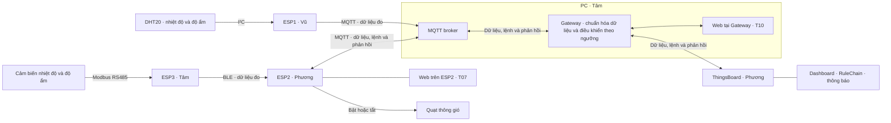
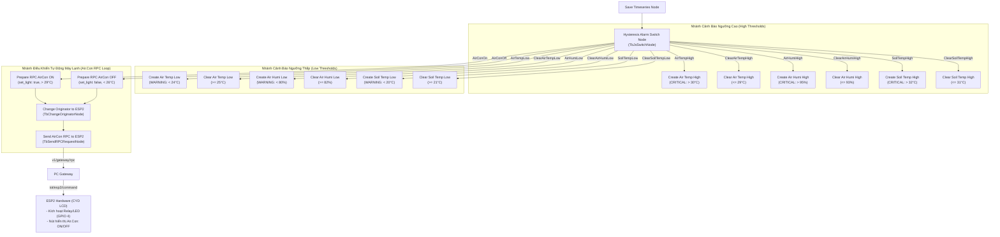
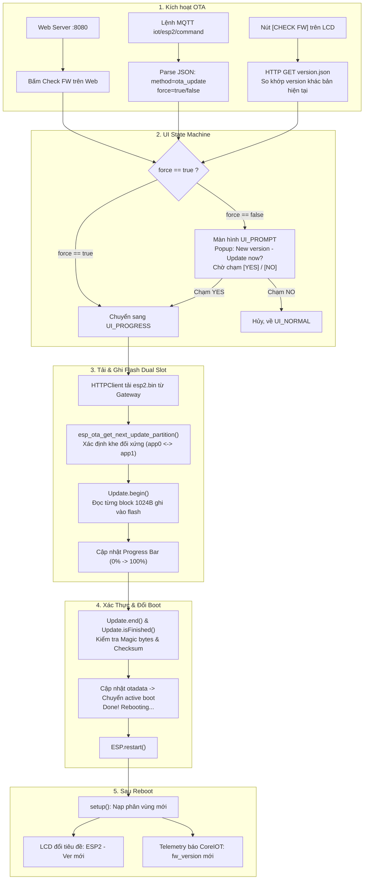

# Tổng quan bài tập lớn IoT Nhóm 3

Hệ thống giám sát nhiệt độ và độ ẩm không khí trong nhà nấm, bật/tắt quạt thông gió theo ngưỡng nhiệt độ và gửi cảnh báo khi độ ẩm ra ngoài dải cấu hình. Nhóm dùng ThingsBoard tự triển khai làm nền tảng giám sát và điều khiển. Loài nấm, giai đoạn trồng và ngưỡng vận hành được chốt sau khi đối chiếu tài liệu và điều kiện thử nghiệm.

## Kiến trúc và phân công

| Thành phần | Phụ trách | Đầu ra và điều kiện nghiệm thu |
|---|---|---|
| ESP1 | Vũ | DHT20 đo nhiệt độ và độ ẩm qua I²C, gửi bản tin MQTT thật. Bàn giao cấu hình, mẫu bản tin và minh chứng đọc cảm biến. T01 cần xác nhận đọc được trên Tasmota. |
| ESP3 | Tâm | Đọc nhiệt độ và độ ẩm qua Modbus RS485 và gửi qua BLE. Bàn giao firmware, sơ đồ đấu nối và log ESP2 nhận đúng dữ liệu. |
| ESP2 | Phương | Nhận dữ liệu ESP3 qua BLE, chuyển tiếp qua MQTT, điều khiển quạt và phục vụ web tại chỗ (T07). Bàn giao firmware, hướng dẫn nạp và log cho thấy lệnh được áp dụng, trạng thái được báo lại. |
| PC | Phương | Dịch vụ môi giới MQTT chuyển bản tin. Gateway chuẩn hóa số đo, xử lý quy tắc bật/tắt tự động, chuyển lệnh đến ESP2 và đồng bộ hai chiều với ThingsBoard. Bàn giao giao diện tại chỗ (T10), hướng dẫn chạy và log tích hợp. |
| ThingsBoard | Tâm | Bàn giao cấu hình mẫu thiết bị, bảng điều khiển, chuỗi quy tắc (RuleChain), thông báo và minh chứng tự triển khai N07 ([hướng dẫn chi tiết](self-hosted-thingsboard-tailscale.md)). Bảng điều khiển hiển thị số đo, điều khiển quạt qua Gateway và nhận trạng thái phản hồi. |
| Báo cáo và video | Vũ tổng hợp | Mỗi thành viên viết phần mình, giao số liệu và đoạn quay. Vũ biên tập PDF theo mẫu, ghép video và đưa mốc minh chứng vào bảng tự đánh giá. |

### Sơ đồ thành phần



Luồng số đo đi từ DHT20 → ESP1 → dịch vụ môi giới MQTT → Gateway → ThingsBoard. Lệnh từ ThingsBoard đi qua Gateway và MQTT đến ESP2. Web T07 gọi bộ xử lý quạt ngay trên ESP2. Web T10 gọi Gateway. Các giao diện dùng trạng thái do ESP2 công bố.

Đường đo thứ hai đi từ cảm biến nhiệt độ và độ ẩm không khí → Modbus RS485 → ESP3 → BLE → ESP2 → MQTT → Gateway → ThingsBoard. Đây là đường tích hợp bắt buộc của kiến trúc nhóm. Tâm và Phương chốt mã cảm biến, cấu hình Modbus và bản tin BLE trước khi tích hợp.

## Phân công viết báo cáo theo mẫu của giảng viên

Bản Word làm việc của nhóm nằm trong repo tại `present/report/source/BaoCao_BaiTapLon_IoT_Nhom3.docx` và được sao chép trực tiếp từ mẫu **BaoCaoMau_BaiTapLon_IoT.docx**. Thành viên trao đổi trước khi sửa để tránh ghi đè thay đổi của nhau. Cả nhóm viết trực tiếp vào các mục được giao. Vũ ghi người phụ trách bằng bình luận trong từng mục. Khi dán nội dung từ nguồn khác, dùng tùy chọn **Chỉ giữ văn bản** để áp dụng định dạng của mẫu tại vị trí dán. Giữ bố cục, thứ tự chương mục, kiểu tiêu đề, bảng và chú thích của mẫu. Khi mục đã có nội dung và minh chứng, người viết để bình luận **Sẵn sàng duyệt**. Lưu ảnh gốc, số liệu và log trong thư mục minh chứng chung.

| Mục trong mẫu | Người viết chính | Nội dung cần bàn giao |
|---|---|---|
| Trang đầu, thông tin nộp bài, bảng phân công, bảng tự đánh giá | Vũ tổng hợp | Thông tin nhóm, đường dẫn GitHub và video, tỷ lệ đóng góp thực tế, mã công nghệ và minh chứng. Phương và Tâm cung cấp minh chứng phần mình. |
| Chương 1. Giới thiệu | Vũ | Bài toán nhà nấm, các công trình liên quan, mục tiêu đo được, danh sách tính năng Fxx và phạm vi. |
| 2.1–2.2 và 2.4–2.6 | Vũ tổng hợp | Sơ đồ kiến trúc, phân rã chức năng, ánh xạ Fxx với Txx/Nxx, công nghệ mới nếu có và bảng phần cứng. Mỗi người xác nhận thành phần mình làm. |
| 2.3.1 Lớp cảm biến | Vũ | DHT20, đại lượng đo, đơn vị, chu kỳ và căn cứ chọn cảm biến. Tâm bổ sung điểm đo Modbus của ESP3. |
| 2.3.2–2.3.3 Lớp giao tiếp và Gateway | Tâm | Luồng MQTT, cấu trúc số đo và lệnh, xử lý tại Gateway. Phương đối chiếu đầu nhận ESP2 và ThingsBoard. Mô tả đường Modbus và BLE từ cảm biến qua ESP3 đến ESP2. |
| 2.3.4 Lớp trí tuệ nhân tạo và 3.5 Trí tuệ nhân tạo | Vũ | Giữ các mục theo mẫu và ghi rõ phạm vi hiện tại dùng điều khiển theo ngưỡng. |
| 2.3.5 Lớp ứng dụng và nền tảng | Phương | Bảng điều khiển, RuleChain, thông báo và phần thay thế CoreIOT bằng ThingsBoard đã được xác nhận. |
| 3.1 Phần cứng và sơ đồ kết nối | Vũ tổng hợp | Mỗi người giao sơ đồ nối dây, mã thiết bị và ảnh phần cứng thật của mình. |
| 3.2 Firmware trên thiết bị | Vũ, Phương và Tâm theo thiết bị | Vũ viết ESP1, Phương viết ESP2 và web T07. Tâm viết ESP3. Vũ ghép vào các mục tương ứng của mẫu. |
| 3.3–3.4 Truyền thông và Gateway | Tâm | Luồng bản tin, xử lý lệnh tự động, giao diện T10, xác nhận lệnh và log tích hợp. Phương cung cấp log từ ESP2. |
| 3.6–3.7 Nền tảng và tính năng nâng cao | Phương | Cấu hình ThingsBoard, kết quả thông báo, minh chứng N07 ([hướng dẫn tự dựng ThingsBoard & Tailscale](self-hosted-thingsboard-tailscale.md)), LVGL hoặc OTA nếu thực hiện. Giữ các mục theo mẫu và ghi trạng thái thực tế. |
| Chương 4. Đo đạc và thử nghiệm | Tâm lập bảng số liệu, Vũ biên tập | Vũ giao số đo cảm biến. Phương giao log trạng thái quạt, dashboard và cảnh báo. Tâm tổng hợp độ trễ, thử đúng ngưỡng và đánh giá từ dữ liệu đã đo. |
| Chương 5. Kết luận và hướng mở rộng | Vũ | Tổng hợp kết quả, hạn chế và hướng phát triển dựa trên minh chứng cả nhóm. |
| Chương 6. Hướng dẫn sử dụng mã nguồn | Tâm tổng hợp | Vũ cung cấp cấu hình ESP1. Phương cung cấp hướng dẫn nạp ESP2 và nhập cấu hình ThingsBoard. Tâm hướng dẫn chạy Gateway và ghép thành quy trình tái lập. |
| Tài liệu tham khảo và phụ lục | Vũ tổng hợp | Dẫn theo IEEE, đối chiếu ít nhất năm nguồn được trích trong nội dung, lưu số liệu chi tiết và khai báo phạm vi sử dụng AI theo yêu cầu. |

Trước khi nộp, Vũ đối chiếu bản Word với mẫu gốc theo từng chương, cập nhật mục lục và kiểm tra bảng, hình, chú thích, số trang và liên kết sau khi xuất PDF. Giữ bố cục và định dạng của mẫu khi nội dung làm thay đổi số trang. Tên PDF theo quy cách `[Mã lớp]_[Mã nhóm]_BaoCaoIoT.pdf`.

## Danh sách bàn giao theo thành viên

- **Vũ:** Cấu hình ESP1, sơ đồ đấu nối DHT20, bản tin MQTT thật và số liệu nhiệt độ–độ ẩm. Viết các mục được giao trong Word chung, quay ESP1, chốt PDF và ghép video.
- **Phương:** Firmware và hướng dẫn nạp ESP2, cấu hình ThingsBoard có thể nhập lại, ảnh hoặc log của web T07, trạng thái quạt, bảng điều khiển và thông báo thực nhận. Viết các mục ESP2 và ThingsBoard trong Word chung, quay phần điều khiển và cảnh báo.
- **Tâm:** Mã nguồn và hướng dẫn chạy Gateway, giao diện T10, bản tin mẫu, log lệnh và phản hồi, bảng số liệu thử nghiệm. Viết các mục giao tiếp, Gateway, thử nghiệm và hướng dẫn chạy trong Word chung, quay phần tích hợp. Bàn giao thêm firmware, sơ đồ đấu nối và log Modbus/BLE.

Mỗi người lưu tệp minh chứng và clip gốc trong thư mục chung, ghi mã Txx/Nxx và mục báo cáo tương ứng để Vũ đối chiếu khi tổng hợp.

## Quy tắc điều khiển

### Điều khiển tự động bằng RuleChain (CoreIOT / ThingsBoard)

Toàn bộ logic tự động hóa được triển khai hoàn chỉnh trên **Root Rule Chain** của CoreIOT (`48e0fd00-d678-11f1-9301-8d833790fa1a`). Nhiệt độ không khí từ cảm biến **ESP1** (DHT20) được đưa vào chuỗi quy tắc để tự động ra lệnh bật/tắt máy lạnh (hệ thống làm mát) trên **ESP2** thông qua cơ chế RPC hai chiều qua Gateway.

- **Cơ chế chống đóng ngắt liên tục (Hysteresis):** Thiết lập dải trễ 3°C giữa ngưỡng bật (> 29°C) và ngưỡng tắt (< 26°C). Khi nhiệt độ vượt 29°C, làm mát bật và duy trì hoạt động đến khi nhiệt độ hạ hẳn dưới 26°C mới ngắt; ngược lại khi đang tắt, máy lạnh chỉ bật lại khi nhiệt độ vượt quá 29°C, tránh việc relay/thiết bị đóng ngắt liên tục quanh một điểm đặt.

| Điều kiện | Trạng thái trước đó | Hành động | Thiết bị thực thi |
|---|---|---|---|
| Nhiệt độ > 29°C | Đang tắt hoặc chưa bật | Bật làm mát (`Air.Con: ON`) | ESP2 (Relay / GPIO 4) |
| 26°C ≤ Nhiệt độ ≤ 29°C | Đang chạy hoặc đang tắt | Giữ nguyên trạng thái hiện tại (dải trễ Hysteresis 3°C) | ESP2 |
| Nhiệt độ < 26°C | Đang chạy | Tắt làm mát (`Air.Con: OFF`) | ESP2 (Relay / GPIO 4) |

- **Luồng truyền lệnh RPC tự động từ RuleChain xuống phần cứng ESP2:**
  1. Node `Hysteresis Alarm Switch` phát hiện `temperature > 29°C` $\rightarrow$ rẽ nhánh qua quan hệ `AirConOn`.
  2. Node `Prepare RPC AirCon ON` (`TbTransformMsgNode`) đóng gói payload RPC:
     ```json
     {"method": "set_light", "params": {"state": true}}
     ```
  3. Node `Change Originator to ESP2` (`TbChangeOriginatorNode`) chuyển thực thể đích sang thiết bị `ESP2`.
  4. Node `Send AirCon RPC to ESP2` (`TbSendRPCRequestNode`) phát lệnh RPC xuống CoreIOT Gateway.
  5. Gateway nhận RPC trên topic `v1/gateway/rpc`, định tuyến qua MQTT nội bộ `iot/esp2/command`.
  6. Vi điều khiển ESP2 nhận lệnh, kích hoạt Relay/LED phần cứng (GPIO 4), cập nhật nút cảm ứng trên màn hình LCD CYD sang **`Air.Con: ON`** và phản hồi trạng thái xác nhận lên CoreIOT.

### Cảnh báo bằng RuleChain

Các ngưỡng cảnh báo môi trường được cấu hình trực tiếp trên Root Rule Chain của CoreIOT. Để tránh việc phát sinh và xóa cảnh báo liên tục (alarm flapping / chattering) khi số đo dao động sát ngưỡng, RuleChain áp dụng **ngưỡng trễ Hysteresis** cho điều kiện tạo (Create Alarm) và xóa cảnh báo (Clear Alarm).

| Thông số | Nguồn | Bình thường (ví dụ) | Kích hoạt cảnh báo thấp | Xóa cảnh báo thấp (Clear) | Kích hoạt cảnh báo cao | Xóa cảnh báo cao (Clear) | Dải trễ (Hysteresis) |
|---|---|---|---|---|---|---|---|
| Nhiệt độ không khí | ESP1 | 26–29°C | < 24°C | ≥ 25°C | > 30°C | ≤ 29°C | 1°C |
| Độ ẩm không khí (RH) | ESP1 | 85–90% | < 80% | ≥ 82% | > 95% | ≤ 93% | 2% RH |
| Nhiệt độ giá thể | ESP3 | Tùy giai đoạn | < 20°C | ≥ 21°C | > 32°C | ≤ 31°C | 1°C |

- **Nguyên lý hoạt động:** Cảnh báo chỉ được kích hoạt khi vượt qua ngưỡng báo động và chỉ tự động giải phóng (Clear Alarm) khi giá trị đã quay trở lại vùng an toàn vượt qua bước trễ Hysteresis tương ứng.

#### Sơ đồ Kiến trúc Root Rule Chain CoreIOT (24 Rule Nodes)



#### Giám sát trên Bảng Điều Khiển CoreIOT (Dashboard Widget)
- Tích hợp widget **`🚨 Bảng Cảnh Báo Ngưỡng Hysteresis (CoreIOT Alarms)`** (`alarms_table` thuộc bundle `alarm_widgets`) hiển thị toàn bộ cảnh báo của các thiết bị trong trang trại với đầy đủ tính năng lọc, hiển thị mức độ nghiêm trọng (*WARNING / CRITICAL*), chi tiết số đo và hỗ trợ thao tác xác nhận (Acknowledge) / giải phóng (Clear).

### Điều khiển máy lạnh / hệ thống làm mát (Air Conditioner)

Nút cảm ứng trên màn hình LCD CYD của ESP2 (`Air.Con: ON/OFF`), giao diện web nội bộ `:8080`, và lệnh RPC `set_light` từ CoreIOT điều khiển bật/tắt máy lạnh (Air Conditioner / hệ thống làm mát) gắn vào ESP2 qua relay (GPIO 4 / LED). Trạng thái máy lạnh được đồng bộ hai chiều giữa LCD, Webserver, Gateway và CoreIOT Dashboard.

### OTA và Cập nhật Firmware

Chức năng cập nhật firmware qua mạng (OTA) được triển khai trên **ESP2** (ESP32-2432S028R tích hợp LCD cảm ứng), hỗ trợ cả hai cơ chế: người dùng chủ động kiểm tra tại chỗ và máy chủ CoreIOT/ThingsBoard ra lệnh từ xa.

#### 1. Ánh xạ Device Profile trên CoreIOT / ThingsBoard
Gateway đăng ký và kết nối các thiết bị xuống CoreIOT (`v1/gateway/connect`) theo đúng profile tương ứng:
* **ESP1**: Device name `ESP1`, Profile **`esp_temp_humi`** (Cảm biến nhiệt độ, độ ẩm qua I²C).
* **ESP2**: Device name `ESP2`, Profile **`esp_hub`** (Hub trung tâm, màn hình hiển thị CYD, điều khiển máy lạnh Air.Con, nhận nhiệt độ đất PT100 qua BLE).
* **ESP3**: Device name `ESP3`, Profile **`esp_ble`** (Cảm biến đo truyền qua BLE/Modbus).

#### 2. Vị trí file nhị phân Firmware (`.bin`) và Kho OTA CoreIOT
* **Sau khi biên dịch bằng PlatformIO:**
  ```text
  firmware/esp2/.pio/build/esp32dev/firmware.bin
  ```
* **Lưu trữ tập trung trên kho CoreIOT OTA Packages (ThingsBoard):**
  * Gói Firmware: **`ESP2 Hub Firmware`**, phiên bản **`1.0.3`**, Profile **`esp_hub`**.
  * File `.bin` thật (1.26 MB) đã được upload trực tiếp vào kho CoreIOT qua REST API (`POST /api/otaPackage/{id}?checksumAlgorithm=SHA256`).
  * Checksum SHA-256: `7a002f593b951eb6889db2a309b526479e567630829584906c799fa8f7b35c2e`.
  * URL tải trực tiếp chính thức từ CoreIOT:
    ```text
    https://fuvi-server.tailc75d93.ts.net/api/otaPackage/{packageId}/download
    ```
* **File lưu tại Gateway để phân phối tải nội bộ (Local Cache Delivery):**
  * Gateway định kỳ hoặc khi có thông báo sẽ tải file nhị phân từ CoreIOT URL về lưu đệm tại:
    ```text
    gateway/firmware/esp2.bin
    ```
  * Gateway phục vụ trực tiếp file này cho ESP2 tại URL nội bộ: `http://<IP_GATEWAY>:8080/firmware/esp2.bin` và endpoint thông tin phiên bản `http://<IP_GATEWAY>:8080/firmware/version.json`.
  * **Lợi ích**: Không dùng bất kỳ external URL nào của bên thứ 3 (như GitHub, S3). ESP2 tải firmware trong mạng LAN chỉ mất 3-5 giây và không phụ thuộc vào kết nối internet bên ngoài của ESP2.

#### 3. Cấu hình Nginx & Minikube Ingress trên máy chủ CoreIOT
* Máy chủ CoreIOT (`fuvi-server.tailc75d93.ts.net` / `192.168.1.32`) chạy cụm Minikube (profile `tb2`) phía sau Docker container reverse proxy `mega-nginx-minikube-tb2`.
* Để hỗ trợ upload các file binary firmware ESP32 có dung lượng lớn (> 1MB), server đã được cấu hình:
  * Nginx Host Container ([`/home/justin/dienmega/thingsboard_2/nginx/nginx.conf`](file:///home/justin/dienmega/thingsboard_2/nginx/nginx.conf)): cấu hình `client_max_body_size 100M;` trong cả block `http` và `server`.
  * Kubernetes Ingress (`tb-ingress` trong namespace `thingboard-dev`): gắn annotation `nginx.ingress.kubernetes.io/proxy-body-size: "100m"`.

#### 4. Các kịch bản và cơ chế thực hiện OTA
* **Kịch bản 1: Người dùng chủ động kiểm tra (Check New FW trên ESP2)**
  * Trên màn hình cảm ứng LCD của ESP2 có nút **`[CHECK FW]`** (song song nút bấm trên Web local `http://<IP_ESP2>:8080/`).
  * Khi bấm, ESP2 gửi HTTP GET kiểm tra `version.json` từ Gateway:
    * Nếu phát hiện phiên bản trên server mới hơn phiên bản hiện tại (`FW_VERSION`): màn hình ESP2 lập tức bật hộp thoại popup:  
      **`FIRMWARE UPDATE — New version: xxx — Update now? [YES] [NO]`**.
    * Người dùng chạm **`YES`** -> ESP2 nạp OTA và tự reboot; chạm **`NO`** -> hủy thông báo.
    * Nếu đang là phiên bản mới nhất: màn hình báo `FW IS UP-TO-DATE!`.
* **Kịch bản 2: Điều khiển từ xa qua CoreIOT / ThingsBoard Dashboard (RPC)**
  * Dashboard tích hợp widget điều khiển OTA động (`CoreIOT OTA Packages — Version Selector & Dispatcher`):
    * Chọn phiên bản mục tiêu từ kho CoreIOT (`v1.0.4`, `v1.0.5`, `v1.0.6`, `v1.0.3`).
    * **`Notify ESP2 (Prompt)`** (`force: false`): Gửi RPC `ota_update`, ESP2 hiển thị popup hỏi xác nhận `[YES] [NO]` trên màn hình thật của thiết bị.
    * **`Force OTA Update`** (`force: true`): Gửi RPC `ota_update`, ESP2 tự động tải nhị phân và nạp ngay lập tức mà không cần tương tác màn hình.
* **Kịch bản 3: Tự tay upload trực tiếp qua Web cục bộ của ESP2**
  * Truy cập `http://<IP_ESP2>:8080/` -> chọn mục *Local OTA Firmware Upload* -> chọn file `.bin` -> bấm *Upload*.
* **Kịch bản 4: Quản lý qua kho OTA Updates trên CoreIOT**
  * Vào CoreIOT -> **Advanced** -> **OTA Updates** -> Tạo gói mới với Device Profile `esp_hub`, upload file `esp2.bin` và gán cho thiết bị `ESP2`.

#### 5. Phân vùng Flash ESP32 & Lưu trình OTA Nội Tại ESP2

**Bảng phân vùng Dual Partition ([`partitions.csv`](../firmware/esp2/partitions.csv)):**
* **`otadata` (0xe000, 8KB):** Lưu trạng thái chỉ định bootloader (số sequence `ota_seq`). Bootloader khi khởi động đọc phân vùng này để xác định nạp code từ `app0` hay `app1`.
* **`app0` (0x10000, 1.5MB):** Khe ứng dụng Slot A.
* **`app1` (0x190000, 1.5MB):** Khe ứng dụng Slot B.
* **Cơ chế chống brick (Fail-Safe):** Khi đang chạy ở `app0`, OTA sẽ nạp vào `app1` (và ngược lại). Chỉ khi toàn bộ stream HTTP kết thúc và kiểm tra mã băm MD5/SHA256 hợp lệ, `otadata` mới được cập nhật để chuyển boot partition. Nếu đứt mạng hay lỗi giữa chừng, `otadata` giữ nguyên nên thiết bị vẫn khởi động an toàn vào phân vùng cũ.



#### 6. Báo cáo trạng thái phiên bản lên CoreIOT
ESP2 gửi kèm trường `fw_version` và nhiệt độ đất `soil_temp` (đo từ PT100 Modbus RS485 qua ESP3 BLE) trong bản tin telemetry định kỳ:
```json
{"values":{"soil_temp":26.5,"light_on":false,"fw_version":"1.0.2"}}
```
Dữ liệu này được Gateway chuẩn hóa và đẩy lên CoreIOT theo thời gian thực (hiển thị tại Latest Telemetry và bảng dữ liệu Dashboard).

## Chuẩn dữ liệu và điều khiển

| Dữ liệu | Quy ước |
|---|---|
| Bản tin ESP1 | Giữ bản tin gốc từ thiết bị. Vũ và Tâm dùng một bản tin thật để chốt chủ đề MQTT và ánh xạ trường. |
| Số đo chuẩn hóa | `source_id`, `zone_id`, `temperature_c` theo °C, `humidity_pct` theo %RH, `ts_ms` theo thời gian Unix mili giây, `time_source`. Nếu Gateway gắn thời điểm nhận, dùng `time_source: "gateway_received"`. |
| ESP3 → ESP2 → Gateway | ESP3 gửi nhiệt độ và độ ẩm qua BLE. ESP2 chuyển tiếp qua MQTT, giữ nguồn `esp3` và số thứ tự mẫu `seq` để đối chiếu khi nghiệm thu. |
| Lệnh quạt | Gateway gửi đến `g3/esp2/command`, ESP2 trả kết quả tại `g3/esp2/ack` với cùng `request_id`. Lệnh đặt trạng thái đích và tắt lưu lệnh (MQTT retain). |
| Trạng thái | ESP2 công bố `fan_on` và `mode` tại `g3/esp2/status`. Khi hết hạn phản hồi, giao diện báo chưa xác nhận. Khi mất mẫu đo, đánh dấu dữ liệu cũ và tạm dừng phát lệnh tự động dựa trên mẫu đó. |

```json
{"source_id":"esp1","zone_id":"zone_01","temperature_c":27.1,"humidity_pct":88.0,"ts_ms":1793764800000,"time_source":"gateway_received"}
```

```json
{"request_id":"cmd-0042","method":"set_fan","params":{"on":true}}
```

```json
{"request_id":"cmd-0042","status":"applied","fan_on":true}
```

`applied` xác nhận firmware đã áp dụng trạng thái đầu ra. Video nghiệm thu cho thấy quạt thực sự đổi trạng thái. Phương và Tâm chốt khóa ThingsBoard, giao thức kết nối và cách ánh xạ lệnh vào cùng cấu trúc trên.

## Nghiệm thu và thang điểm

| Chỉ số | Cách đo |
|---|---|
| Đúng ngưỡng | Thử tăng qua ngưỡng bật, giữ giữa hai ngưỡng, giảm qua ngưỡng tắt. Ghi số đo và trạng thái quạt theo từng bước. |
| Độ trễ dữ liệu | Từ lúc Gateway nhận bản tin đến lúc mẫu tương ứng hiển thị trên ThingsBoard. |
| Độ trễ điều khiển | Từ lúc Gateway gửi lệnh MQTT đến lúc nhận `applied` với cùng `request_id`. Ghi riêng các lần hết hạn. |
| Phản ứng môi trường | Ghi nhiệt độ và độ ẩm trước và sau khi quạt chạy, kèm điều kiện thử. |
| Tỷ lệ nhận BLE từ ESP3 | So số bản tin hợp lệ, không trùng tại ESP2 với số bản tin ESP3 gửi trong cùng lượt thử. |

Các phép đo độ trễ cần lặp lại và báo cáo số lần thử, trung bình, nhỏ nhất và lớn nhất. Video 5–10 phút nên thể hiện số đo thật, một chu kỳ bật/tắt tự động, thao tác thủ công, thông báo thực nhận và minh chứng triển khai ThingsBoard.

Theo thang điểm trong thông báo, T07/T08/T10/T11/T12/T13 có tổng dự kiến **5,5 điểm** nếu hoàn thành và có minh chứng. T01 thêm 0,5 điểm khi đọc I²C trên Tasmota. T02/T03 thuộc phạm vi bắt buộc của kiến trúc nhóm, đóng góp 2,5 điểm khi có minh chứng đọc Modbus và truyền BLE. Cùng với T07/T08/T10/T11/T12/T13, tổng điểm công nghệ dự kiến là 8 điểm nếu hoàn thành đủ. T14 là phương án bổ sung nếu triển khai OTA có minh chứng. Công nghệ áp trần 8 điểm, báo cáo tối đa 2 điểm, N07 và N03 cùng thuộc phần điểm cộng tối đa 1 điểm. Tổng điểm bài tập lớn tối đa 10.

## Nguồn tham khảo cho báo cáo

| Bài và năm xuất bản | Tạp chí và xếp hạng | DOI hoặc nguồn | Dùng cho phần nào |
|---|---|---|---|
| Evaluation of Different Pasteurization and Sterilization Methods for Oyster Mushroom Substrates (2024) | Journal of Microbiology, Biotechnology and Food Sciences. [SJR 2025 Q3](https://journalsbase.com/journals/journal-of-microbiology-biotechnology-and-food-sciences). | [10.55251/jmbfs.10428](https://doi.org/10.55251/jmbfs.10428) | Bối cảnh nuôi trồng. Bảng 3 dẫn lại điều kiện theo giai đoạn từ Stamets. Nghiên cứu chính đánh giá xử lý giá thể. |
| Design and Evaluation of a Compact IoT-Enabled Microfarm for Decentralized Urban Agriculture Applied to the Cultivation of Pleurotus ostreatus (2025) | Sustainability. [SJR 2025 Q1 ở Geography, Planning and Development, Q2 ở Computer Networks and Communications](https://researchcloud.net/journal/2071-1050). | [10.3390/su172210332](https://doi.org/10.3390/su172210332) | Công trình liên quan, cách đo nhiệt độ và độ ẩm trong buồng trồng và phương pháp đánh giá. |
| Design and Implementation of a Cost-Aware and Smart Oyster Mushroom Cultivation System (2024) | Smart Agricultural Technology. [SJR 2025 Q1 ở Agricultural and Biological Sciences (miscellaneous)](https://www.resurchify.com/impact/details/21101111783). | [10.1016/j.atech.2024.100439](https://doi.org/10.1016/j.atech.2024.100439) | Công trình liên quan và so sánh phạm vi đo lường. |
| The Development of an Automatic Environment Control System in Greenhouses for Phoenix Oyster Mushrooms Using the Internet of Things (2026, số 8(1)) | Journal of Applied Informatics and Technology. [Có trong TCI](https://ph01.tci-thaijo.org/index.php/jait/journal-insight). [Danh sách của trường ghi Group 1](https://it.msu.ac.th/wp-content/uploads/2023/10/Collaborative-journals-AJCC-AUCC-2024-edited-Oct.5-1.pdf). Kỳ xếp hạng 2026 và quartile SJR chưa xác minh. | [10.14456/jait.2026.2](https://doi.org/10.14456/jait.2026.2) | Tham khảo thiết kế quạt và bộ phun ẩm riêng cho nhà nấm bào ngư Phoenix. |
| DHT20 Data Sheet (2021) | Tài liệu kỹ thuật ASAIR, không áp dụng xếp hạng tạp chí. | [PDF của hãng](https://www.aosong.com/userfiles/files/media/Data%20Sheet%20DHT20%20%20A1.pdf), không có DOI. | Giao tiếp I²C, điều kiện đo và sai số công bố của cảm biến. |

Các bản PDF đã tải được lưu trong [thư mục tài liệu tham khảo của nhóm trên Google Drive](https://drive.google.com/drive/folders/1QgDkBjaxtsZ0zJZVQ1gTQvduthe19O6d?usp=sharing).

Dẫn tối thiểu năm nguồn phù hợp trong nội dung theo kiểu IEEE. Chọn dải nhiệt–ẩm theo đúng loài và giai đoạn. Đánh giá nguyên mẫu bằng số liệu do nhóm đo. Có thể bổ sung [đặc tả MQTT 3.1.1 của OASIS](https://docs.oasis-open.org/mqtt/mqtt/v3.1.1/os/mqtt-v3.1.1-os.html) nếu đây là phiên bản nhóm triển khai.

- [Thông báo bài tập lớn](ThongBao_BaiTapLon_IoT.docx)
- [Mẫu báo cáo bài tập lớn](BaoCaoMau_BaiTapLon_IoT.docx)
