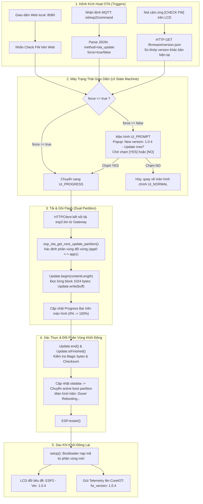

# ESP2 — Display, BLE Central, Light Control & Web Gateway (C/C++ PlatformIO)

Firmware C/C++ (Arduino framework) cho bo mạch **ESP32-2432S028R** (ESP32 tích hợp màn hình LCD cảm ứng).

## 1. Tính năng
* **BLE NUS Central:** Quét và kết nối thiết bị `ESP3-PT100`, nhận dữ liệu nhiệt độ đất PT100 Modbus (`soil_temp`).
* **Màn hình LCD ILI9341:** Dòng đầu hiển thị `ESP2 - Ver: xxx`, hiển thị `Soil: XX.X C (PT100)` từ BLE ESP3, trạng thái kết nối Wi-Fi, 2 nút cảm ứng điều khiển đèn và kiểm tra cập nhật.
* **Cảm ứng điện trở XPT2046:**
  * Chạm ô bên trái: Bật/tắt đèn LED tại chỗ.
  * Chạm ô bên phải: **`CHECK FW`** để chủ động kiểm tra phiên bản mới từ Gateway.
  * Hộp thoại OTA Prompt: Nút cảm ứng **`YES`** (xanh) để nạp OTA, **`NO`** (đỏ) để hủy.
* **Đèn RGB onboard:** Active-Low (GPIO 4, 16, 17).
* **Wi-Fi & Fallback AP:** Tự động kết nối Wi-Fi hoặc mở AP `ESP2-Setup` (192.168.4.1).
* **MQTT:** Telemetry `iot/esp2/telemetry` (kèm `soil_temp`, `light_on`, `fw_version`), Command `iot/esp2/command`, Result `iot/esp2/result`.
* **Web Server & OTA (Port 8080):**
  * `GET /`: Giao diện giám sát, nút bật/tắt đèn, nút *Check for New FW*, form upload binary nạp OTA tại chỗ.
  * `POST /light`: Điều khiển đèn.
  * `POST /check_fw`: Kích hoạt kiểm tra firmware mới từ Gateway.
  * `POST /ota`: Nhận luồng nhị phân nạp trực tiếp qua HTTP.

## 2. OTA Firmware Delivery Architecture
1. **Kho lưu trữ tập trung CoreIOT**: File `.bin` (1.26MB) được lưu trữ tại CoreIOT OTA Packages repository (`ESP2 Hub Firmware 1.0.3` ... `1.0.6`, Profile `esp_hub`).
2. **Download URL trên CoreIOT**: `https://fuvi-server.tailc75d93.ts.net/api/otaPackage/{id}/download`.
3. **Gateway Caching & Local Delivery**: Gateway nhận lệnh từ CoreIOT, tải file binary về bộ đệm `gateway/firmware/esp2.bin` và sinh `version.json`, sau đó cấp phát qua HTTP nội bộ `http://<IP_GATEWAY>:8080/firmware/esp2.bin` cho ESP2 tải trong mạng LAN (tốc độ cao, không cần token CoreIOT phức tạp).

---

## 3. Kiến trúc Phân vùng Flash ESP32 (Flash Partition Table)

Cấu hình phân vùng được định nghĩa trong file [`partitions.csv`](partitions.csv) cho chip ESP32 (Flash 4MB):

```csv
# Name,   Type, SubType, Offset,   Size,     Flags
nvs,      data, nvs,     0x9000,   0x5000,
otadata,  data, ota,     0xe000,   0x2000,
app0,     app,  ota_0,   0x10000,  0x180000,
app1,     app,  ota_1,   0x190000, 0x180000,
```

### Mục đích chi tiết từng phân vùng:

| Tên phân vùng | Loại (`Type`) | Phụ (`SubType`) | Địa chỉ Offset | Kích thước | Dung lượng (KB/MB) | Mục đích & Trách nhiệm |
|:---|:---:|:---:|:---:|:---:|:---:|:---|
| **`nvs`** | `data` | `nvs` | `0x9000` | `0x5000` | 20 KB | **Non-Volatile Storage**: Lưu trữ dữ liệu cấu hình không bay hơi của ESP32 (thông tin mạng Wi-Fi SSID/PASS, trạng thái hệ thống, cấu hình lưu qua thư viện `Preferences`). |
| **`otadata`** | `data` | `ota` | `0xe000` | `0x2000` | 8 KB | **OTA Data / Boot Selector**: Lưu trạng thái chỉ định phân vùng boot cho Bootloader. Chứa 2 sector luân phiên (mỗi sector 4KB) lưu số thứ tự sequence `ota_seq` và trạng thái hợp lệ của firmware. Bootloader khi khởi động đọc phân vùng này đầu tiên để biết cần nạp mã thực thi từ `app0` hay `app1`. |
| **`app0`** | `app` | `ota_0` | `0x10000` | `0x180000` | 1,536 KB (1.5 MB) | **Khe ứng dụng chính (Slot A)**: Chứa bản firmware ban đầu hoặc bản firmware A đang chạy. Khi đang chạy trên `app0`, quá trình OTA sẽ ghi vào `app1`. |
| **`app1`** | `app` | `ota_1` | `0x190000` | `0x180000` | 1,536 KB (1.5 MB) | **Khe ứng dụng dự phòng (Slot B)**: Chứa bản firmware nâng cấp kế tiếp (firmware B). Khi đang chạy trên `app1`, quá trình OTA kế tiếp sẽ ghi đè vào `app0`. |

### Cơ chế tráo đổi A/B (Ping-Pong Switching) & Chống Brick (Fail-Safe):
1. **Hoạt động song song an toàn:** ESP2 không bao giờ ghi đè trực tiếp lên phân vùng ứng dụng nó đang chạy.
   - Nếu đang chạy trên `app0` $\rightarrow$ ghi firmware mới vào `app1`.
   - Nếu đang chạy trên `app1` $\rightarrow$ ghi firmware mới vào `app0`.
2. **Bảo vệ toàn vẹn (Fail-Safe):**
   - Trong quá trình tải stream HTTP từ Gateway, các khối dữ liệu 1024 bytes được ghi tuần tự vào khe flash đối xứng.
   - Chỉ khi nào toàn bộ file được nạp xong và hàm `Update.end()` xác nhận **Magic Byte `0xE9`** cùng **mã băm toàn vẹn (Checksum)** thành công, thì phân vùng `otadata` mới được cập nhật để trỏ Bootloader sang khe mới.
   - Nếu xảy ra sự cố (đứt Wi-Fi, sập nguồn, file hỏng), phân vùng `otadata` giữ nguyên $\rightarrow$ ESP32 khởi động lại vẫn chạy an toàn trên phân vùng cũ, **không bao giờ bị brick phần cứng**.

---

## 4. Lưu trình Xử lý OTA Phía ESP2 (Firmware Internal Flowchart)



---

## 5. Biên dịch & Nạp Firmware Ban Đầu
```sh
pio run
pio run -t upload --upload-port /dev/cu.usbserial-140
pio device monitor -b 115200
```
